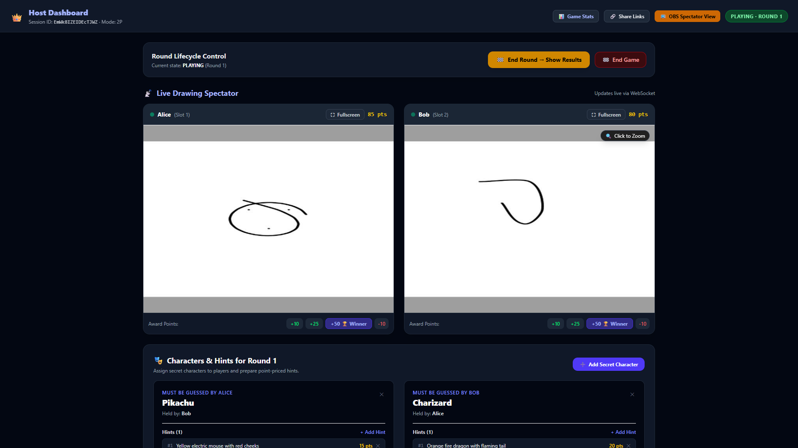
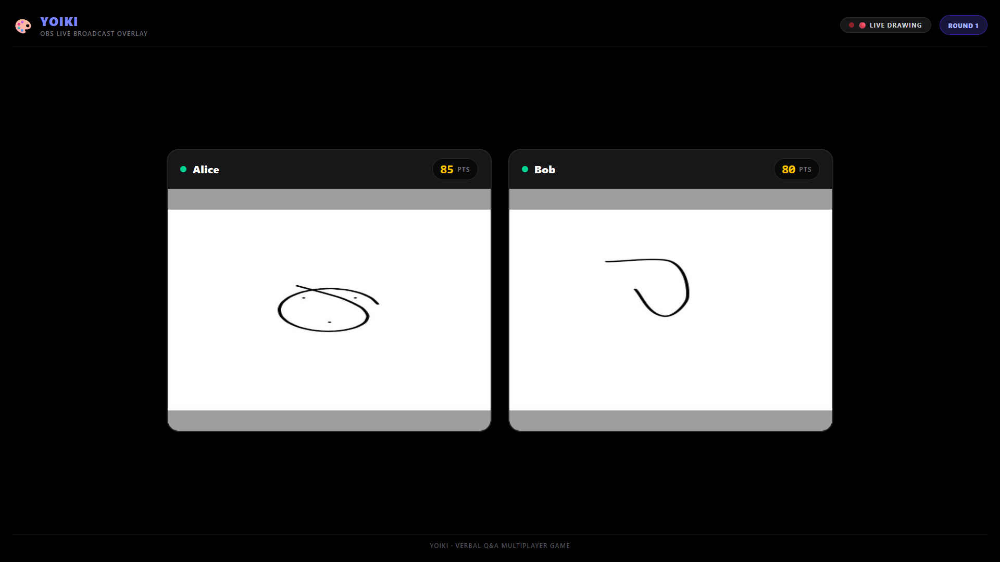
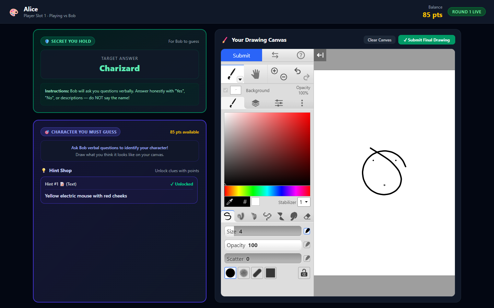
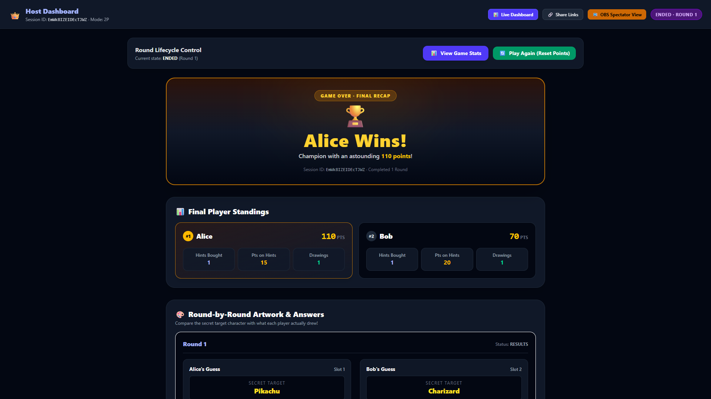

<p align="right">
  <a href="README.md">English</a> | <strong>Bahasa Indonesia</strong>
</p>

# 🎨 YoiKi (与意気) — Game Tebak Karakter & Menggambar Multiplayer Real-Time

[](https://opensource.org/licenses/MIT)
[](https://workers.cloudflare.com/)
[](https://react.dev/)
[](#-penerapan-cloud-gratis-nol-rupiah-di-cloudflare)

**YoiKi** adalah game menggambar dan menebak karakter multipemain real-time pribadi yang dirancang khusus untuk sesi santai bersama teman (*game nights*), siaran langsung (*livestreaming*), dan perekaman siaran OBS. Dibangun sepenuhnya di atas **infrastruktur serverless edge Cloudflare**, aplikasi ini berjalan dengan biaya **$0/bulan (Gratis)** memanfaatkan kuota paket free-tier Cloudflare.

---

## 📸 Tangkapan Layar (Screenshots)

| Dasbor Host | Tampilan Penonton OBS (1920×1080) |
| :---: | :---: |
|  |  |

| Ruang Pemain & Kanvas Klecks | Hasil Akhir & Podium |
| :---: | :---: |
|  |  |

---

## ✨ Fitur Utama (Features)

### 🖌️ Studio Menggambar Digital Klecks
- **Peralatan Gambar Lengkap**: Integrasi mesin kanvas [Bitbof Klecks](https://github.com/bitbof/klecks) dengan responsivitas goresan kuas (*brush*), pensil, dan penghapus yang halus.
- **Dukungan Layer (Lapisan)**: Mendukung multi-layer dengan pengaturan opasitas dan pengurutan ulang urutan layer.
- **Pemilih Warna & Pengatur Ukuran Presisi**: Pengaturan diameter kuas, slider transparansi, serta palet warna lengkap.
- **Navigasi Kanvas Canggih**: Riwayat *undo/redo* tanpa batas, bersihkan kanvas (*clear*) dengan konfirmasi keamanan, serta navigasi geser (*pan*) dan pembesaran (*zoom*).
- **Pengiriman Gambar Otomatis**: Ekspor PNG resolusi tinggi dengan satu klik langsung disimpan ke Cloudflare R2.

### ⚡ Tampilan Penonton Real-Time & WebSockets
- **Streaming Kanvas Ganda Bersamaan**: Saksikan kedua pemain menggambar secara bersamaan (*side-by-side*) dengan latensi sangat rendah.
- **Optimasi Bandwidth Rendah**: Klien hanya mengirimkan pratinjau JPEG 640×480 (kualitas 0.5) setiap ~2.5 detik **hanya jika ada perubahan piksel pada kanvas**.
- **Tanpa Beban Penyimpanan Frame Sementara**: Pratinjau langsung disiarkan secara instan di memori melalui WebSocket, **tidak pernah disimpan ke R2** untuk menjaga biaya tetap $0.
- **Pemulihan Koneksi Otomatis**: Menangani *reconnect* dan sinkronisasi status otomatis jika pemain memuat ulang (*refresh*) atau koneksi terputus sesaat.

### 📺 Mode Siaran Siap Pakai untuk OBS & Streamer
- **Resolusi Standar 1080p**: Tampilan khusus penonton layar penuh (`/spectator/:sessionId?token=...`) yang dirancang pas untuk *Browser Source* OBS (1920×1080).
- **Bebas Spoiler (*Spoiler-Free*)**: Menampilkan kanvas kedua pemain, nama, skor terkini, dan status babak secara bersih tanpa membocorkan nama karakter rahasia.
- **Tema Gelap Kontras Tinggi**: Tata letak modern yang nyaman dilihat oleh penonton siaran dengan tipografi tajam.

### 🔒 Kerahasiaan Karakter & Anti-Kecurangan Server-Side
- **Isolasi Karakter Tingkat Server**: Target tebakan disamarkan secara kriptografis pada API dan WebSocket (`??? (Secret)`); nama target mustahil diintip lewat DOM maupun payload jaringan sebelum Host membukanya.
- **Mekanisme Rahasia Silang 2 Pemain**: Pemain A memegang karakter target milik Pemain B (dan menjawab pertanyaan Pemain B), sedangkan Pemain B memegang karakter milik Pemain A.
- **Autentikasi Peran Berbasis Token**: Token unik `nanoid` memisahkan izin Host, Pemain, dan Penonton secara ketat.

### 💡 Toko Petunjuk Strategis (*Hint Shop*)
- **Petunjuk Teks & Gambar Khusus**: Host dapat membuat petunjuk teks dan mengunggah gambar referensi dengan harga poin yang dapat disesuaikan.
- **Penyembunyian Server**: Petunjuk terkunci tidak akan dikirimkan ke pemain sebelum dibeli secara sah.
- **Pengurangan Saldo Otomatis**: Saldo poin pemain langsung dipotong melalui buku besar transaksi (*transaction ledger*).
- **Pencegahan Akses Silang**: Pemain hanya dapat melihat dan membeli petunjuk yang dialokasikan khusus untuk karakter tebakannya.

### 👑 Pusat Kendali Host yang Lengkap
- **Pemantau Gambar Langsung**: Kartu pratinjau kedua pemain dengan indikator status koneksi (*online/offline*).
- **Modal Perbesar Layar Penuh (*Zoom Modal*)**: Inspeksi detail goresan gambar dalam resolusi tinggi dengan kontrol zoom (+/-) dan pintasan keyboard instan (`Tab` atau tombol panah untuk berganti pemain).
- **Pemberian Poin Cepat**: Tombol skor sekali klik (`+10`, `+25`, `+50 🏆 Winner`, `-10`) serta penyesuaian nilai poin kustom beserta catatannya.
- **Kontrol Babak Lengkap**: Memulai babak, mengelola karakter, menambah petunjuk, membuka nama karakter, dan menutup sesi.

### 🏆 Rekap Pertandingan, Galeri Karya & Riwayat Transaksi
- **Podium & Peringkat Pemenang**: Perhitungan pemenang otomatis dengan selebrasi podium juara 1 dan juara 2.
- **Statistik Belanja Petunjuk**: Rincian total poin yang dihabiskan untuk membeli petunjuk dibandingkan poin yang diperoleh dari tebakan.
- **Galeri Karya Seni**: Galeri permanen yang menampilkan gambar akhir berkualitas tinggi dari seluruh babak.
- **Buku Besar Audit Poin**: Riwayat transaksi lengkap yang mencatat setiap penambahan, pengurangan, maupun pembelian petunjuk.

---

## 🎮 Konsep & Aturan Permainan

- **Mode Tebak & Gambar 2 Pemain Bersamaan**:
  - **Pemain A** memegang karakter rahasia yang harus ditebak oleh **Pemain B**, dan bertugas menjawab pertanyaan verbal dari Pemain B.
  - **Pemain B** memegang karakter rahasia yang harus ditebak oleh **Pemain A**, dan bertugas menjawab pertanyaan verbal dari Pemain A.
  - Kedua pemain saling bertanya jawab secara lisan dan menggambar tebakan mereka secara bersamaan di kanvas **Klecks**!
  - Kedua pemain dapat membeli petunjuk teks dan gambar menggunakan saldo poin yang mereka miliki.
- **Mode 1 Pemain**:
  - Host memegang karakter rahasia dan menjawab pertanyaan pemain solo selagi pemain menggambar tebakannya.
- **Dasbor Host**:
  - Pratinjau penonton langsung yang diperbarui setiap 2.5 detik via WebSockets.
  - Modal pembesar layar penuh dengan navigasi keyboard (`Tab` / `←` / `→`) dan tombol skor kilat.
  - Pengelolaan karakter dan petunjuk rahasia dengan fitur unggah gambar referensi.
- **Tampilan Penonton OBS**:
  - Tampilan *overlay* tanpa spoiler yang siap ditangkap (*screen capture*) pada resolusi 1920×1080.
- **Rekap Hasil Akhir**:
  - Podium pemenang, klasemen pemain, total audit petunjuk, galeri gambar akhir, dan buku besar transaksi poin.

---

## 🏗️ Arsitektur & Teknologi

- **Frontend**: React 19 + TypeScript + Vite + Tailwind CSS v4.
- **Mesin Menggambar**: Kompilasi tersemat Bitbof Klecks dengan jembatan komunikasi `postMessage`.
- **API Backend**: Cloudflare Worker menggunakan framework [Hono](https://hono.dev/).
- **Basis Data Relasional**: Cloudflare D1 (SQLite) dengan migrasi skema terversi.
- **Relay WebSocket**: Cloudflare SQLite Durable Object (`GameRoom`) dengan WebSocket Hibernation API.
- **Penyimpanan Objek**: Cloudflare R2 untuk penyimpanan gambar karya akhir dan referensi (tanpa biaya keluar data / $0 egress).

Untuk diagram arsitektur mendalam dan rincian protokol, silakan baca [docs/ARCHITECTURE.md](docs/ARCHITECTURE.md).

---

## 💰 Penerapan Cloud Gratis (Nol Rupiah di Cloudflare)

YoiKi dirancang secara efisien agar selalu berada dalam batas kuota gratis Cloudflare:

| Layanan | Batas Kuota Paket Gratis | Bagaimana YoiKi Menggunakannya |
| :--- | :--- | :--- |
| **Workers HTTP** | 100.000 permintaan / hari | Panggilan REST API & jabat tangan (*handshake*) awal WebSocket. |
| **Durable Objects** | 100.000 event / hari, 13.000 GB-detik | **WebSocket Hibernation API** mengistirahatkan komputasi saat hening (0 GB-detik saat menganggur). |
| **Pratinjau Langsung** | Sementara di memori | Diteruskan via WebSocket; **tidak pernah ditulis ke R2**. |
| **Cloudflare D1** | 5.000.000 baris baca / hari | Migrasi skema relasional dan buku besar transaksi poin. |
| **Cloudflare R2** | 10 GB-bulan, 1 juta penulisan / bulan | Gambar karya akhir yang sudah selesai dikirim (hanya 2 penulisan per babak) dengan **$0 biaya egress**. |
| **Cloudflare Pages** | Bandwidth tanpa batas | Hosting aplikasi web SPA tanpa biaya. |

Untuk panduan langkah demi langkah penerapannya, silakan baca [docs/DEPLOYMENT_GUIDE.md](docs/DEPLOYMENT_GUIDE.md).

---

## 🚀 Panduan Memulai di Komputer Lokal

### Prasyarat
- [Node.js](https://nodejs.org/) v18+
- npm v10+

### 1. Kloning Repositori & Pasang Dependensi
```bash
git clone https://github.com/Valcio13/YoiKi.git
cd YoiKi
npm install
```

### 2. Jalankan Migrasi Basis Data Lokal
```bash
npm run db:migrate
```

### 3. Jalankan Server Pengembangan
Jalankan server Cloudflare Worker dan antarmuka Vite frontend secara bersamaan:
```bash
npm run dev
```

- **Frontend**: [http://localhost:5173](http://localhost:5173)
- **Worker API**: [http://localhost:8787](http://localhost:8787)

---

## 🧪 Uji Coba Visual Otomatis (E2E Playtest)

YoiKi menyediakan skrip pengujian otomatis 3 browser menggunakan Playwright dengan Chromium/Edge:

```bash
node playtest.mjs
```

Skrip ini memverifikasi seluruh alur permainan mulai dari pembuatan sesi, isolasi rahasia karakter, proses menggambar simultan, streaming ganda kanvas secara langsung, pemotongan saldo poin petunjuk, pengiriman gambar, hingga kalkulasi podium pemenang akhir.

---

## 📚 Indeks Dokumentasi

- [Arsitektur & Model Data](docs/ARCHITECTURE.md)
- [Panduan Penerapan Cloudflare Gratis ($0/bulan)](docs/DEPLOYMENT_GUIDE.md)
- [Referensi REST API & Protokol WebSocket](docs/API_REFERENCE.md)

---

## 📄 Lisensi

Lisensi MIT. Bitbof Klecks dilisensikan di bawah Lisensi Apache 2.0.
