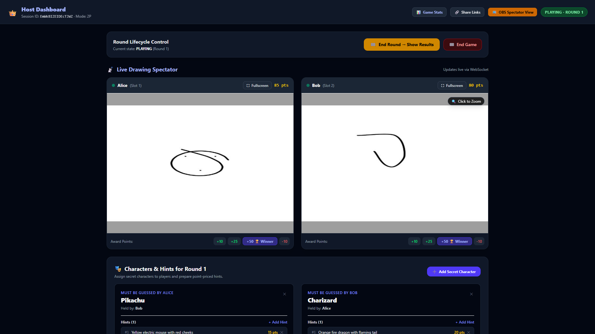
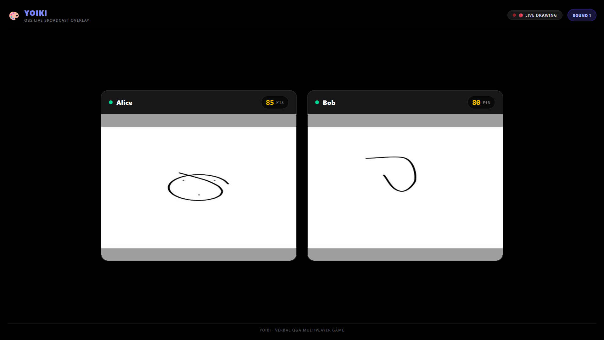
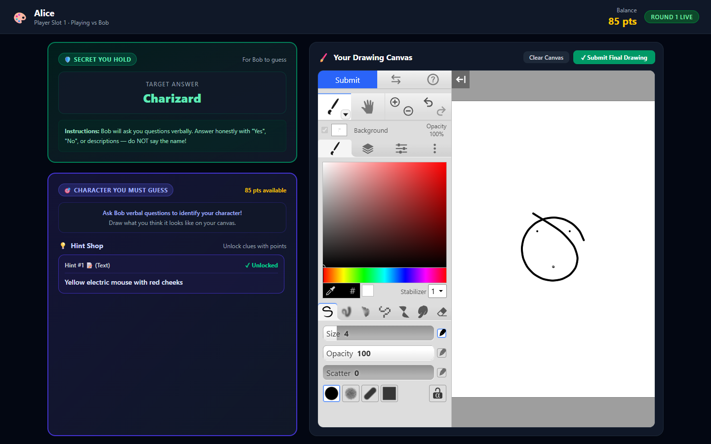
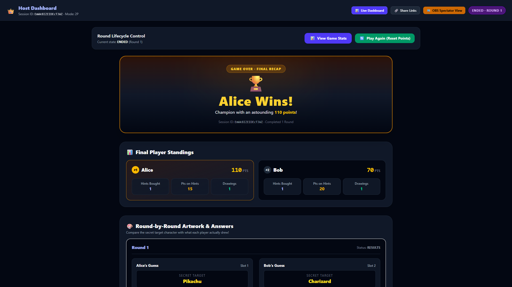

<p align="right">
  <strong>English</strong> | <a href="README.id.md">Bahasa Indonesia</a>
</p>

# 🎨 YoiKi (与意気) — Private Real-Time Multiplayer Character Guessing Game

[](https://opensource.org/licenses/MIT)
[](https://workers.cloudflare.com/)
[](https://react.dev/)
[](#-zero-cost-cloudflare-deployment)

**YoiKi** is a private, real-time multiplayer drawing and character guessing game designed specifically for game nights, livestreams, and OBS broadcast recording. Built entirely on **Cloudflare's serverless edge infrastructure**, it operates at **$0/month** on Cloudflare's free tier.

---

## 📸 Screenshots

| Host Dashboard | OBS Spectator View (1920×1080) |
| :---: | :---: |
|  |  |

| Player Room & Klecks Canvas | Final Results & Podium |
| :---: | :---: |
|  |  |

---

## ✨ Features

### 🖌️ Klecks Digital Drawing Studio
- **Full Drawing Tool Suite**: Integrated [Bitbof Klecks](https://github.com/bitbof/klecks) engine featuring responsive brush strokes, pencil, and eraser.
- **Layers & Blending**: Support for multi-layer artwork with opacity controls and layer reordering.
- **Precision Color Picker & Sizing**: Fine-grained brush diameter, opacity sliders, and full palette selection.
- **Canvas Operations**: Unlimited undo/redo history, canvas clearing with confirmation, and smooth zoom/pan viewport navigation.
- **Direct Cloud Submission**: Single-click drawing submission exported as high-resolution PNG directly to Cloudflare R2 storage.

### ⚡ Real-Time Live Spectator & WebSockets
- **Dual Simultaneous Streaming**: Watch both players draw live on a side-by-side split screen with sub-second latency.
- **Bandwidth-Optimized Canvas Diffs**: Client transmits 640×480 JPEG previews (~0.5 quality) throttled at ~2.5s **only when canvas pixels change**.
- **Zero Temporary Storage Writes**: Live previews are transiently relayed through memory via WebSockets, never written to R2.
- **Resilient Reconnection**: Automatic reconnection and state resynchronization when players refresh or experience network jitter.

### 📺 OBS & Livestream Broadcast Mode
- **1080p Optimized Display**: Dedicated full-screen OBS layout (`/spectator/:sessionId?token=...`) formatted specifically for 1920×1080 window or browser source capture.
- **Spoiler-Free Presentation**: Clean broadcast view shows player canvases, nicknames, live points, and round timers while keeping secret character identities hidden.
- **High-Contrast Dark Theme**: Streamer-ready UI with clear typography, status tags, and high visual clarity.

### 🔒 Cryptographic Secrecy & Fair Play
- **Server-Side Target Isolation**: Guessing targets are cryptographically masked at the API and WebSocket layer (`??? (Secret)`); secret names are never exposed in DOM or network payloads before the host triggers the reveal.
- **Cross-Player Secrecy**: In 2-player mode, Player A holds Bob's secret target and answers Bob's questions, while Player B holds Alice's secret target and answers Alice's questions.
- **Role-Based Token Authentication**: Secure nanoid tokens isolate Host, Participant, and Spectator permissions.

### 💡 Strategic Hint Economy
- **Custom Hint Shop**: Hosts can configure multiple text clues and reference images per character with custom point pricing.
- **Server-Side Redaction**: Clues remain locked and masked on the server until explicitly purchased by the assigned player.
- **Automated Point Deductions**: Instant balance updates via transactional ledger upon purchase.
- **Cross-Purchase Prevention**: Strict validation ensures players can never purchase or peek at opponents' hints.

### 👑 Comprehensive Host Command Center
- **Live Canvas Monitor**: Real-time side-by-side player preview cards with participant connection health indicators.
- **Fullscreen Zoom Modal**: Inspect artwork in high resolution with smooth zoom controls (+/-) and fast keyboard navigation (`Tab` or `Arrow keys` to switch between players).
- **Quick-Scoring Actions**: One-click score buttons (`+10`, `+25`, `+50 🏆 Winner`, `-10`) plus custom point delta adjustments with reasons.
- **Game Lifecycle Control**: Start rounds, create characters, assign hint packages, reveal character identities, and transition sessions.

### 🏆 Match Recap, Gallery & Audit Ledger
- **Podium & Standings**: Automatic winner celebration with 1st and 2nd place podium rankings.
- **Hint Spending Summary**: Detailed breakdown of points spent on clues versus points earned through drawings and guesses.
- **Artwork Gallery**: Permanent gallery displaying final submitted high-resolution artwork from all rounds.
- **Point Audit Ledger**: Complete tamper-evident transaction history recording every reward, penalty, and hint transaction.

---

## 🎮 Game Concept & Rules

- **Simultaneous 2-Player Guess & Draw**:
  - **Player A** holds the secret character that **Player B** must guess, and answers Player B's verbal questions.
  - **Player B** holds the secret character that **Player A** must guess, and answers Player A's verbal questions.
  - Both players ask verbal questions to each other and draw their guesses simultaneously in the integrated **Klecks** canvas!
  - Both players can purchase text and image hints using their point balance.
- **1-Player Mode**:
  - The Host holds the character and answers the solo player's questions while the player draws.
- **Host Dashboard**:
  - Live side-by-side spectator preview updating every 2.5s via WebSockets.
  - Seamless fullscreen zoom modal with smooth zooming, player switching (`Tab` / `←` / `→`), and quick scoring buttons (`+10`, `+25`, `+50 🏆 Winner`, `-10`).
  - Secret character and hint management with reference image uploads.
- **OBS Spectator Mode**:
  - Clean, high-contrast, spoiler-free overlay (1920×1080) designed for OBS browser source capture.
- **End-Game Match Recap**:
  - Winner podium, player standings, hint audit totals, artwork gallery, and full transaction history ledger.

---

## 🏗️ Architecture & Technology Stack

- **Frontend**: React 19 + TypeScript + Vite + Tailwind CSS v4.
- **Drawing Engine**: Bitbof Klecks embedded build with sandboxed `postMessage` bridge.
- **Backend API**: Cloudflare Worker running [Hono](https://hono.dev/).
- **Relational Database**: Cloudflare D1 (SQLite) with versioned migrations.
- **WebSocket Relay**: Cloudflare SQLite Durable Object (`GameRoom`) with edge Hibernation API.
- **Object Storage**: Cloudflare R2 for final drawings and reference images ($0 egress fees).

For deep architecture diagrams and protocol details, see [docs/ARCHITECTURE.md](docs/ARCHITECTURE.md).

---

## 💰 Zero-Cost Cloudflare Deployment

YoiKi is intentionally engineered to stay well within Cloudflare’s Free Plan quotas:

| Service | Free Plan Limit | How YoiKi Uses It |
| :--- | :--- | :--- |
| **Workers HTTP** | 100,000 requests / day | REST API calls & initial WebSocket handshake only. |
| **Durable Objects** | 100,000 events / day, 13,000 GB-s | **WebSocket Hibernation API** suspends execution when idle (0 GB-s compute costs). |
| **Live Previews** | Transient in memory | 640×480 JPEG (0.5 quality) diffs streamed over WS; **never written to R2**. |
| **Cloudflare D1** | 5,000,000 read rows / day | Versioned relational migrations and point transaction ledger. |
| **Cloudflare R2** | 10 GB-months, 1M writes / month | Final completed drawings only (2 writes per round) with **$0 egress fees**. |
| **Cloudflare Pages** | Unlimited bandwidth | Zero-cost SPA hosting. |

For step-by-step setup instructions, see [docs/DEPLOYMENT_GUIDE.md](docs/DEPLOYMENT_GUIDE.md).

---

## 🚀 Getting Started Locally

### Prerequisites
- [Node.js](https://nodejs.org/) v18+
- npm v10+

### 1. Clone & Install
```bash
git clone https://github.com/Valcio13/YoiKi.git
cd YoiKi
npm install
```

### 2. Apply Local Database Migrations
```bash
npm run db:migrate
```

### 3. Run Dev Server
Start both the Cloudflare Worker and Vite frontend concurrently:
```bash
npm run dev
```

- **Frontend**: [http://localhost:5173](http://localhost:5173)
- **Worker API**: [http://localhost:8787](http://localhost:8787)

---

## 🧪 Automated Visual Playtest

YoiKi includes an automated 3-browser end-to-end playtest using Playwright with Chromium/Edge:

```bash
node playtest.mjs
```

This verifies the complete gameplay flow from session creation, character secrecy isolation, simultaneous drawing, live dual-canvas spectator streaming, point deductions, drawing submission, and final winner podium calculations.

---

## 📚 Documentation Index

- [Architecture & Data Models](docs/ARCHITECTURE.md)
- [Zero-Cost Cloudflare Deployment Guide](docs/DEPLOYMENT_GUIDE.md)
- [REST API & WebSocket Protocol Reference](docs/API_REFERENCE.md)

---

## 📄 License

MIT License. Bitbof Klecks is licensed under the Apache 2.0 License.
