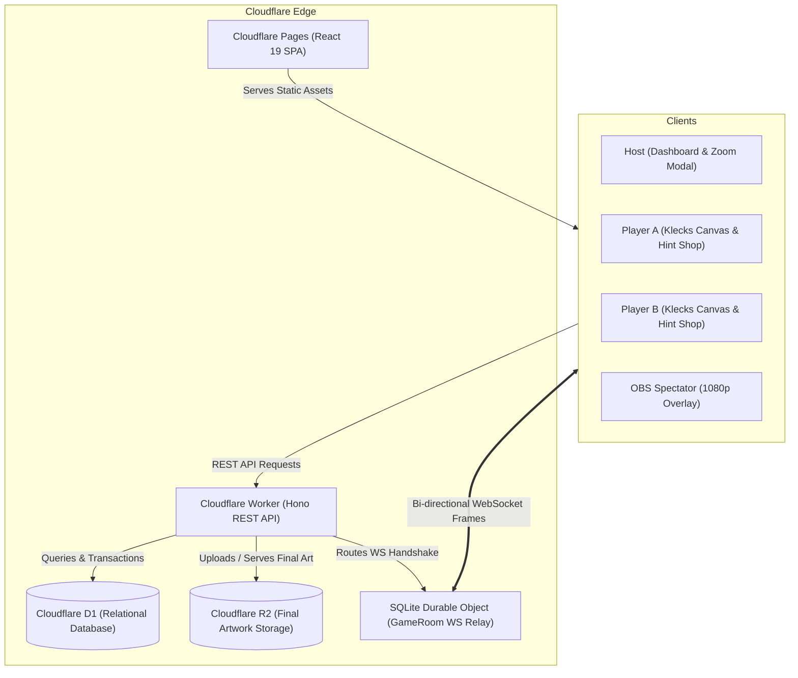
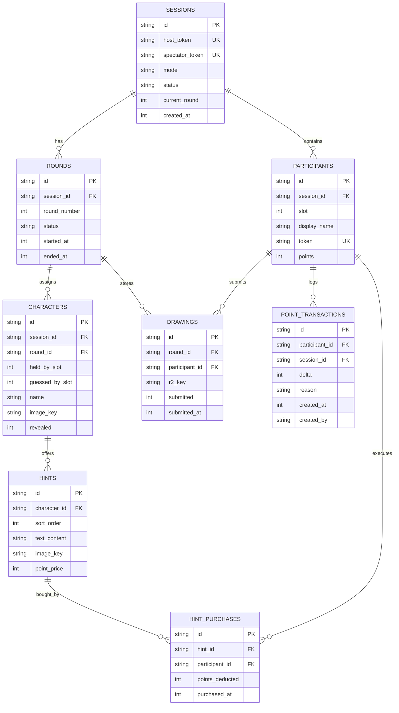

# 🏛️ YoiKi Architecture Specification

YoiKi is a low-latency, multiplayer character guessing game engine built to run completely within **Cloudflare's Free Tier** ($0/month operating cost).

---

## 1. High-Level System Architecture

---

## 2. Core Subsystems

### A. Real-Time WebSocket Hibernation Engine (`GameRoom.ts`)
- Utilizes Cloudflare’s **WebSocket Hibernation API** (`ctx.acceptWebSocket(server, tags)`).
- When connections are idle between canvas changes, instances sleep with **0 GB-seconds compute charges**.
- Incoming frames wake the DO, evaluate authentication tags attached to the socket, and fan-out:
  - **Player Drawing Previews (`preview`)**: Broadcast strictly to Host and Spectators, isolated from opponent player sockets.
  - **Player Status (`player_status`)**: Real-time presence reporting (online/offline) when sockets connect or disconnect.
  - **State Updates (`state_update`)**: Host broadcasts round transitions, hint creation, point adjustments, and character reveals to all active sockets.

### B. Client-Side Drawing Engine (Klecks Embed)
- Embedded locally via [`public/klecks/index.html`](file:///f:/Yoiki/frontend/public/klecks/index.html).
- Sandboxed `postMessage` bridge:
  - `klecks:request-snapshot`: Renders the active canvas to an off-screen 640×480 canvas, serializing to `image/jpeg` at 0.5 quality (~20–25 KB).
  - `klecks:request-submit`: Exports a 100% loss-less PNG blob, uploading to Cloudflare R2 via `multipart/form-data`.
  - `klecks:clear`: Resets canvas layers to blank with user confirmation.
- **Auto-Save Drafts**: Automatically saves active canvas states to browser `localStorage` every 10 seconds under key `gd_draft_{sessionId}_{participantId}_round_{roundNumber}`.

### C. Zero-Cost Storage Strategy
1. **Live Preview Frames**: Handled entirely in volatile DO memory and streamed transiently over WebSockets. **Never stored on disk or R2**, preserving Class A/B operation limits.
2. **Final Artworks**: Saved exclusively upon round completion as a single PNG upload to R2, tagged with `{sessionId}/{roundId}/{participantId}.png`.
3. **Game State & Ledger**: Stored in D1 SQLite using versioned migrations.

---

## 3. Data Model & Database Schema

All tables are defined in [`worker/migrations/0001_init.sql`](file:///f:/Yoiki/worker/migrations/0001_init.sql):

---

## 4. Security & Role Isolation Matrix

Each role possesses a cryptographically random token (32-byte hex) generated at session creation.

| Capability | Host | Player (Guesser) | Player (Holder) | Spectator |
| :--- | :---: | :---: | :---: | :---: |
| **View Secret Character Name (Active)** | ✅ Full | ❌ Redacted (`???`) | ✅ Visible | ❌ Redacted |
| **View Secret Character Name (Results)** | ✅ Full | ✅ Revealed | ✅ Revealed | ✅ Revealed |
| **Buy Hint for Target Character** | ❌ N/A | ✅ Deducts Pts | ❌ Forbidden (403) | ❌ N/A |
| **View Unpurchased Hint Details** | ✅ Full | ❌ Redacted (null) | ❌ Redacted | ❌ Redacted |
| **Receive Opponent Drawing Preview** | ✅ Live | ❌ Blocked | ❌ Blocked | ✅ Live |
| **Award / Deduct Player Points** | ✅ Full | ❌ Blocked | ❌ Blocked | ❌ Blocked |
| **Lifecycle Control (Start / End Round)**| ✅ Full | ❌ Blocked | ❌ Blocked | ❌ Blocked |
